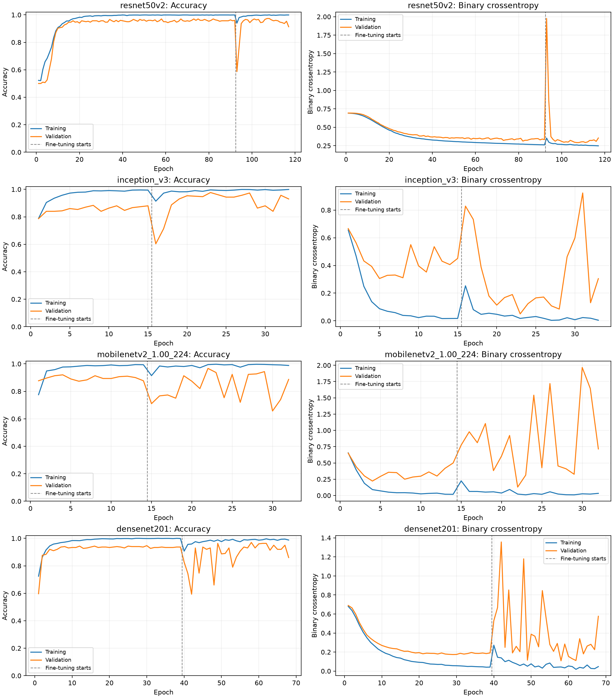

# ผลการฝึกและทดสอบโมเดล 1–4

ใช้ train 2,100 ภาพ, validation 300 ภาพ และ test 599 ภาพ (safe 299, unsafe 300)
ไม่นับ desktop.ini ในโฟลเดอร์ test เพราะไม่ใช่ไฟล์รูปภาพ
ฝึกส่วนหัวและ fine-tune ช่วงละไม่เกิน 100 epochs โดยหยุดเมื่อ validation loss ไม่ดีขึ้น 10 epochs
เลือกโมเดลจาก validation loss เท่านั้น แล้วทดสอบภาพตามลำดับคงที่ โดยคะแนน unsafe > 0.5 ถือเป็น unsafe
การอ่านและย่อภาพใช้ขั้นตอนเดียวกับการฝึก: TensorFlow decode_image และ resize แบบ bilinear
ใช้ architecture, Rescaling(1/255), optimizer และขอบเขตการ freeze layers ตาม notebook เดิม
ทุกโมเดลฝึกตามลำดับบน NVIDIA GeForce RTX 4070 Ti ใน WSL2

| Model | Head epochs | Fine-tune epochs | Selected phase | Test accuracy | Unsafe recall | Unsafe F1 | Test loss |
|---|---:|---:|---|---:|---:|---:|---:|
| model_1_ResNet50V2(Adam) | 92 | 25 | fine_tune | 81.97% | 99.00% | 84.62% | 0.4437 |
| model_2_InceptionV3 | 15 | 18 | fine_tune | 84.81% | 97.67% | 86.56% | 0.7781 |
| model_3_MobileNetV2 | 14 | 18 | fine_tune | 78.96% | 99.67% | 82.60% | 1.8142 |
| model_4_DenseNet201 | 39 | 29 | fine_tune | 85.98% | 99.00% | 87.61% | 0.6335 |

## model_1_ResNet50V2(Adam)

Best model: [model_1_ResNet50V2(Adam)/best_model.keras](model_1_ResNet50V2(Adam)/best_model.keras)

| Actual class | Predicted safe | Predicted unsafe |
|---|---:|---:|
| safe | 194 | 105 |
| unsafe | 3 | 297 |

Per-image test predictions: [model_1_ResNet50V2(Adam)/evaluation/test_predictions.csv](model_1_ResNet50V2(Adam)/evaluation/test_predictions.csv)
Unlabeled unseen-image predictions: [model_1_ResNet50V2(Adam)/evaluation/unseen_predictions.csv](model_1_ResNet50V2(Adam)/evaluation/unseen_predictions.csv)

เวลาฝึก: 7.2 นาที ขนาด input: [256, 256] Batch size: 50

## model_2_InceptionV3

Best model: [model_2_InceptionV3/best_model.keras](model_2_InceptionV3/best_model.keras)

| Actual class | Predicted safe | Predicted unsafe |
|---|---:|---:|
| safe | 215 | 84 |
| unsafe | 7 | 293 |

Per-image test predictions: [model_2_InceptionV3/evaluation/test_predictions.csv](model_2_InceptionV3/evaluation/test_predictions.csv)
Unlabeled unseen-image predictions: [model_2_InceptionV3/evaluation/unseen_predictions.csv](model_2_InceptionV3/evaluation/unseen_predictions.csv)

เวลาฝึก: 2.6 นาที ขนาด input: [128, 128] Batch size: 50

## model_3_MobileNetV2

Best model: [model_3_MobileNetV2/best_model.keras](model_3_MobileNetV2/best_model.keras)

| Actual class | Predicted safe | Predicted unsafe |
|---|---:|---:|
| safe | 174 | 125 |
| unsafe | 1 | 299 |

Per-image test predictions: [model_3_MobileNetV2/evaluation/test_predictions.csv](model_3_MobileNetV2/evaluation/test_predictions.csv)
Unlabeled unseen-image predictions: [model_3_MobileNetV2/evaluation/unseen_predictions.csv](model_3_MobileNetV2/evaluation/unseen_predictions.csv)

เวลาฝึก: 2.3 นาที ขนาด input: [224, 224] Batch size: 32

## model_4_DenseNet201

Best model: [model_4_DenseNet201/best_model.keras](model_4_DenseNet201/best_model.keras)

| Actual class | Predicted safe | Predicted unsafe |
|---|---:|---:|
| safe | 218 | 81 |
| unsafe | 3 | 297 |

Per-image test predictions: [model_4_DenseNet201/evaluation/test_predictions.csv](model_4_DenseNet201/evaluation/test_predictions.csv)
Unlabeled unseen-image predictions: [model_4_DenseNet201/evaluation/unseen_predictions.csv](model_4_DenseNet201/evaluation/unseen_predictions.csv)

เวลาในรอบ fine-tuning ที่เริ่มต่อ: 15.3 นาที ขนาด input: [224, 224] Batch size: 32

## ปัญหาใน notebook ที่จัดการในการรันครั้งนี้

- พาธข้อมูลและพาธบันทึกโมเดลอ้างโฟลเดอร์ของผู้ใช้เดิม ตัวรันใช้โฟลเดอร์โปรเจกต์ปัจจุบัน
- ทุก notebook ใช้ชื่อ checkpoint เดียวกัน ครั้งนี้แยกไฟล์ตามโมเดลและช่วงฝึก
- DenseNet201 บันทึกด้วยชื่อไฟล์ของ ResNet RMSprop ครั้งนี้แยกบันทึก DenseNet201
- DenseNet201 ย่อ unseen เป็น 256x256 แต่โมเดลรับ 224x224 ครั้งนี้ใช้ขนาด input ของโมเดล
- Notebook สุ่มลำดับ test; การทำนายและอ่าน labels คนละรอบอาจทำให้ confusion matrix จับคู่ผิด ครั้งนี้จับคู่ภาพและ label ตามลำดับคงที่
- Unseen 10 ภาพไม่มี labels ที่ยืนยันแล้ว จึงรายงานการทำนายแต่ไม่รายงาน accuracy
- ไม่ได้แก้ notebook ต้นฉบับหรือเขียนทับไฟล์โมเดลที่มีอยู่ก่อน
- DenseNet201 ปิด XLA เพื่อแก้การคอมไพล์ fine-tuning ที่ใช้เวลานาน และเริ่มต่อจาก checkpoint ส่วนหัวที่ฝึกเสร็จแล้ว
- ตัวเลขในรายงานมาจากการฝึกหนึ่งครั้งและ test set ที่มีอยู่ในโปรเจกต์
